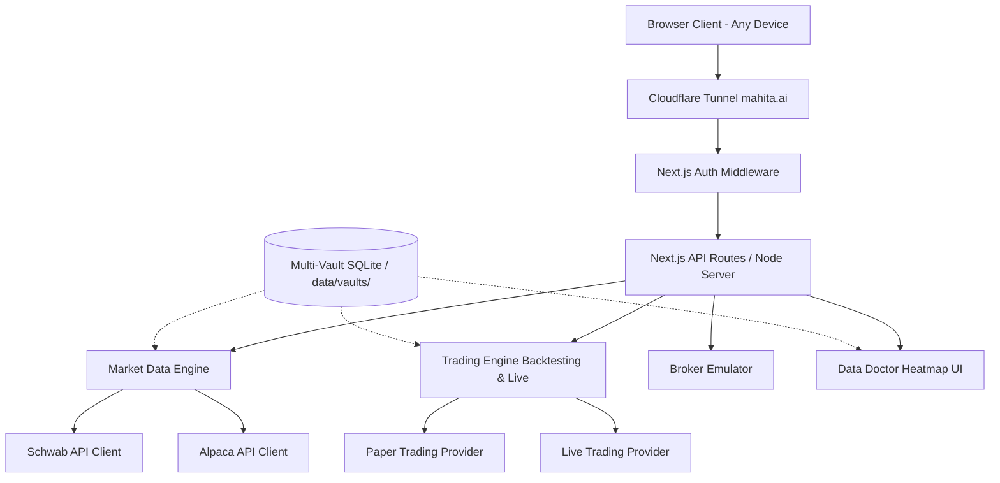

# 01 - System Architecture Blueprint

## Executive Summary
This document outlines the high-level system architecture for the new trading terminal to be hosted on `mahita.ai`. The system is designed to provide institutional-grade features (backtesting, live trading, multi-broker support) via a web browser while ensuring user data privacy and extremely low latency by executing logic and storing data on the local host machine.

## 1. High-Level Architecture Overview

The application follows a monolithic client-server architecture with several distinct layers:

## 2. Technology Stack
*   **Frontend**: Next.js (React), Tailwind CSS, Lightweight Charts (TradingView) for fast chart rendering.
*   **Backend**: Next.js API Routes, Prisma ORM, SQLite/PostgreSQL Database.
*   **Infrastructure**: Hosted locally, served publicly over Cloudflare Tunnel over `mahita.ai`.

## 3. Core System Components
*   **MarketDataStore**: Proxy caching service that orchestrates all external ticker HTTP REST requests and WebSockets. Fetches data, dynamically aggregates custom timeframes (e.g. `15m` from `1m`), and isolates vendor interactions.
*   **VaultManager**: Dedicated SQLite registry isolating database files by source (e.g., `schwab.db`, `yahoo.db`, `master.db`) to ensure data integrity and prevent corruption.
*   **Data Doctor**: Command center web UI running constant health checks on local datasets vs remote truth endpoints, displaying findings in a matrix.
*   **TradingEngine**: Evaluates JSON-structured logic ASTs to issue synchronous buy/sell events.
*   **BrokerageProvider**: Interface standard allowing the engine to seamlessly switch between Paper/Mock and Schwab/Live accounts.

