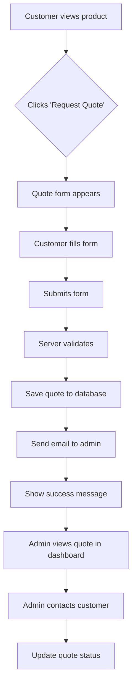

# Mahita Jewelry Store - Implementation Plan

## Project Overview

Transform mahita.ai into a fully functional Indian jewelry e-commerce platform with admin management capabilities, inspired by Tanishq (Tata) and similar Indian jewelry retailers.

---

## Requirements Analysis

### Customer-Facing Features

| Feature | Description |
|---------|-------------|
| Product Catalog | Grid/list view of all jewelry items with images, names, categories |
| Product Detail Pages | Large images, descriptions, specifications, "Request Quote" button |
| Category Navigation | Filter by jewelry type (necklaces, rings, earrings, bangles, etc.) |
| Search Functionality | Search products by name, category, or description |
| Request Quote System | Form on each product page sending to admin-configured email |
| Responsive Design | Mobile-friendly browsing experience |

### Admin-Facing Features

| Feature | Description |
|---------|-------------|
| Admin Dashboard | Overview of products, quotes, and site statistics |
| Product Management | Add, edit, delete products with images and descriptions |
| Image Upload | Upload multiple images per product |
| Quote Management | View, manage, and track quote requests |
| Email Configuration | Set custom notification email for quote submissions |
| Category Management | Create and manage product categories |

### Technical Requirements

| Component | Technology |
|-----------|------------|
| Server | Node.js + Express.js |
| Database | SQLite (file-based, simple to deploy) |
| File Storage | Local filesystem (uploads/ directory) |
| Email | Nodemailer (SMTP) |
| Authentication | Session-based with bcrypt |
| Image Handling | Multer for uploads |

---

## Database Schema

### Products Table

```sql
CREATE TABLE products (
  id INTEGER PRIMARY KEY AUTOINCREMENT,
  name TEXT NOT NULL,
  description TEXT,
  category_id INTEGER,
  price REAL,
  images TEXT, -- JSON array of image paths
  is_active INTEGER DEFAULT 1,
  created_at DATETIME DEFAULT CURRENT_TIMESTAMP,
  updated_at DATETIME DEFAULT CURRENT_TIMESTAMP
);
```

### Categories Table

```sql
CREATE TABLE categories (
  id INTEGER PRIMARY KEY AUTOINCREMENT,
  name TEXT NOT NULL,
  slug TEXT UNIQUE NOT NULL,
  description TEXT,
  sort_order INTEGER DEFAULT 0
);
```

### Quotes Table

```sql
CREATE TABLE quotes (
  id INTEGER PRIMARY KEY AUTOINCREMENT,
  product_id INTEGER,
  customer_name TEXT NOT NULL,
  customer_email TEXT NOT NULL,
  customer_phone TEXT,
  customer_message TEXT,
  status TEXT DEFAULT 'pending', -- pending, contacted, completed, cancelled
  created_at DATETIME DEFAULT CURRENT_TIMESTAMP,
  FOREIGN KEY (product_id) REFERENCES products(id)
);
```

### Settings Table

```sql
CREATE TABLE settings (
  key TEXT PRIMARY KEY,
  value TEXT
);
```

---

## API Endpoints

### Public API

| Method | Endpoint | Description |
|--------|----------|-------------|
| GET | /api/products | List all products (with filters) |
| GET | /api/products/:id | Get single product |
| GET | /api/categories | List all categories |
| GET | /api/categories/:slug | Get category by slug |
| POST | /api/quotes | Submit quote request |

### Admin API (Protected)

| Method | Endpoint | Description |
|--------|----------|-------------|
| GET | /api/admin/dashboard | Dashboard stats |
| POST | /api/admin/products | Create product |
| PUT | /api/admin/products/:id | Update product |
| DELETE | /api/admin/products/:id | Delete product |
| POST | /api/admin/upload | Upload product image |
| GET | /api/admin/quotes | List quote requests |
| PUT | /api/admin/quotes/:id | Update quote status |
| GET | /api/admin/settings | Get settings |
| PUT | /api/admin/settings | Update settings |
| POST | /api/admin/categories | Create category |
| PUT | /api/admin/categories/:id | Update category |
| DELETE | /api/admin/categories/:id | Delete category |

---

## Page Structure

### Customer Pages

| Route | Description |
|-------|-------------|
| / | Homepage with featured products |
| /products | Product listing with filters |
| /product/:id | Product detail page |
| /category/:slug | Category product listing |
| /search | Search results |
| /quote/:productId | Quote form (modal or separate page) |

### Admin Pages

| Route | Description |
|-------|-------------|
| /admin | Admin dashboard |
| /admin/products | Product management |
| /admin/products/new | Add new product |
| /admin/products/:id/edit | Edit product |
| /admin/categories | Category management |
| /admin/quotes | Quote requests |
| /admin/settings | Site settings (email config) |

---

## Implementation Phases

### Phase 1: Foundation

- [ ] Set up Express.js with project structure
- [ ] Configure SQLite database with better-sqlite3
- [ ] Create database schema and seed initial data
- [ ] Set up session-based authentication
- [ ] Create admin login page

### Phase 2: Admin Features

- [ ] Build admin dashboard with stats
- [ ] Implement product CRUD operations
- [ ] Add image upload with Multer
- [ ] Create category management
- [ ] Build settings page (email configuration)

### Phase 3: Customer Features

- [ ] Design homepage with featured products
- [ ] Build product listing page with filters
- [ ] Create product detail page
- [ ] Add category navigation
- [ ] Implement search functionality

### Phase 4: Quote System

- [ ] Create quote request form on product pages
- [ ] Implement quote submission with validation
- [ ] Set up email notifications via Nodemailer
- [ ] Build admin quote management view

### Phase 5: Polish & Deploy

- [ ] Add responsive CSS styling (jewelry-appropriate theme)
- [ ] Add loading states and error handling
- [ ] Optimize images
- [ ] Test Cloudflare Tunnel deployment

---

## File Structure

```
mahita/
├── server.js              # Main entry point
├── database.js            # Database setup and queries
├── routes/
│   ├── api.js            # API routes
│   ├── admin.js          # Admin page routes
│   └── pages.js          # Customer page routes
├── middleware/
│   ├── auth.js          # Authentication middleware
│   └── upload.js         # File upload middleware
├── public/
│   ├── css/              # Stylesheets
│   ├── js/               # Client-side scripts
│   └── uploads/          # Product images
├── views/
│   ├── admin/            # Admin HTML templates
│   └── customer/         # Customer HTML templates
├── data/
│   └── jewelry.db        # SQLite database
├── package.json
└── README.md
```

---

## UI/UX Design Direction

### Visual Theme (Inspired by Tanishq)

- **Primary Colors**: Gold (#D4AF37), Deep Red (#8B0000), Royal Blue (#4169E1)
- **Background**: Cream/Off-white (#FFFEF5)
- **Typography**: Elegant serif for headings, clean sans-serif for body
- **Imagery**: High-quality product photos with zoom capability
- **Layout**: Clean grid-based product cards, generous whitespace
- **Accents**: Traditional Indian motifs subtly incorporated

### Key UI Components

1. **Header**: Logo, navigation, search bar
2. **Hero Section**: Featured collection banner
3. **Product Grid**: 3-4 columns on desktop, 2 on tablet, 1 on mobile
4. **Product Card**: Image, name, category, "Request Quote" button
5. **Product Detail**: Image gallery, description, specifications, quote form
6. **Footer**: Contact info, links, social media

---

## Email Configuration

The admin can configure SMTP settings through the admin panel:

| Setting | Description |
|---------|-------------|
| smtp_host | SMTP server hostname |
| smtp_port | SMTP server port |
| smtp_user | SMTP username |
| smtp_pass | SMTP password |
| notification_email | Email to receive quote notifications |

---

## Quote Form Fields

| Field | Type | Required |
|-------|------|----------|
| Product | Auto-filled | Yes |
| Name | Text | Yes |
| Email | Email | Yes |
| Phone | Tel | No |
| Message | Textarea | No |

---

## Mermaid Diagram: Quote Flow



---

## Next Steps

1. **Confirm Plan**: Review this plan and confirm to proceed
2. **Begin Phase 1**: Set up foundation (Express, database, auth)
3. **Iterate**: Build incrementally, testing each phase

---

## Questions for Clarification

1. **Email Service**: Do you have an existing Gmail/Outlook account for sending quote notifications, or should we set up a dedicated email service? 

Answer: Set it up.

2. **Initial Products**: Do you have product images ready, or should we create placeholder products first?

Answer: Create placeholder products.

3. **Product Categories**: What categories do you want initially? (e.g., Necklaces, Rings, Earrings, Bangles, Bracelets, Maang Tikka, etc.)

Answer: Necklaces, Rings, Earrings, Bangles, Bracelets, Maang Tikka, option to add others from admin dash

4. **Custom Domain**: Is mahita.com already pointing to Cloudflare? Should we configure the tunnel now or test locally first?


Answer: Configured, but need to test.
currently, mahita.ai says
Error 1016 Ray ID: 9d038fb20c8c22de • 2026-02-19 06:03:28 UTC
Origin DNS error
What happened?
You've requested a page on a website (mahita.ai) that is on the Cloudflare network. Cloudflare is currently unable to resolve your requested domain (mahita.ai).

Please see https://developers.cloudflare.com/support/troubleshooting/http-status-codes/cloudflare-1xxx-errors/error-1016/ for more details.

What can I do?
If you are a visitor of this website:
Please try again in a few minutes.

If you are the owner of this website:
Check your DNS settings. If you are using a CNAME origin record, make sure it is valid and resolvable. Additional troubleshooting information here.


